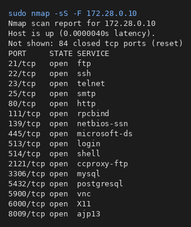
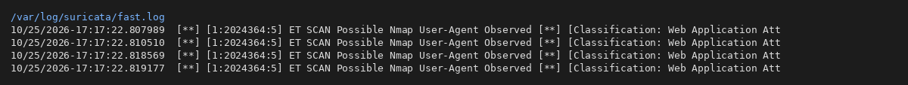
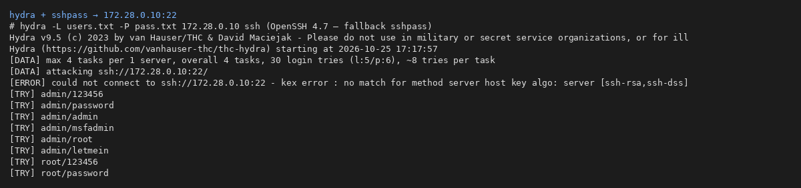
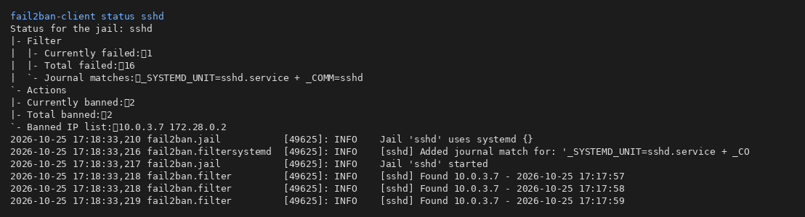

# 🛡️ Домашнее задание 13-03: Защита сети

**Выполнил:** Сыч Кирилл  
**Группа:** SFLT-58  
**Дата:** 25 октября 2026

[](https://suricata.io/)
[](https://github.com/fail2ban/fail2ban)

---

## 📋 Содержание

- [Подготовка стенда](#-подготовка-стенда)
- [Задание 1: Разведка nmap](#-задание-1-разведка-nmap)
- [Задание 2: Hydra и Fail2Ban](#-задание-2-hydra-и-fail2ban)

---

## 🧪 Подготовка стенда

Установлено на **хосте** (Ubuntu):

- **Suricata** 7.0.3 — IDS на интерфейсе Docker `br-8155605f2906` (сеть `lab13`, `172.28.0.0/24`)
- **Fail2Ban** — jail **`[sshd]`**, `enabled = true` ([config/fail2ban-host/jail.local](config/fail2ban-host/jail.local) → `/etc/fail2ban/jail.local`)
- **openssh-server** на хосте (для демонстрации блокировки)
- **nmap**, **hydra**

| Роль | Компонент | Адрес |
|------|-----------|--------|
| Защищаемая система | Metasploitable 2 (Docker) | **172.28.0.10** |
| IDS | Suricata (systemd) | мост **172.28.0.0/24** |
| Злоумышленник | nmap / hydra с хоста и из Docker | **172.28.0.1**, **172.28.0.2** |

```bash
./lab/lab-up.sh          # Metasploitable 172.28.0.10
sudo systemctl enable --now suricata fail2ban ssh
```

---

## 🎯 Задание 1: Разведка nmap

### Команды (выполнены с sudo)

```bash
sudo nmap -sA -F -oN scans/task1-sA.txt 172.28.0.10
sudo nmap -sT -F -oN scans/task1-sT.txt 172.28.0.10
sudo nmap -sS -F -oN scans/task1-sS.txt 172.28.0.10
sudo nmap -sV -F -oN scans/task1-sV.txt 172.28.0.10
```

Логи: [scans/](scans/).

### Службы (фрагмент `-sV`)

FTP **vsftpd 2.3.4**, SSH **OpenSSH 4.7p1**, HTTP **Apache 2.2.8**, MySQL **5.0.51a**, PostgreSQL **8.3.x**, SMB, Telnet и др. (см. `task1-sV.txt`).

### Suricata — события

**`/var/log/suricata/fast.log`** (копия: [logs/suricata/task1-fast-full.log](logs/suricata/task1-fast-full.log)):

```
ET SCAN Possible Nmap User-Agent Observed
{TCP} 172.28.0.1:39978 -> 172.28.0.10:80
```

**Комментарий:** при `-sV` nmap обращается к HTTP с типичным User-Agent — сработали правила **Emerging Threats** (класс *Web Application Attack*). Дополнительно в **eve.json** фиксируются **flow**-события между **172.28.0.1** и **172.28.0.10** ([logs/suricata/task1-events.jsonl](logs/suricata/task1-events.jsonl)).

### Fail2Ban — задание 1

При чистом сканировании портов **SSH-брутфорса нет** → jail `sshd` без новых банов. Jail **включён** (`enabled = true`).

### 📸 Скриншоты

  


---

## 🎯 Задание 2: Hydra и Fail2Ban

### Файлы hydra

[attack/users.txt](attack/users.txt), [attack/pass.txt](attack/pass.txt) (в т.ч. **msfadmin / msfadmin**).

### Fail2Ban — настройка `[sshd]`

```ini
[sshd]
enabled = true
maxretry = 3
findtime = 120
bantime = 600
```

Файл: `/etc/fail2ban/jail.local` (шаблон в репозитории).

### Hydra

```bash
hydra -L attack/users.txt -P attack/pass.txt 172.28.0.10 ssh
```

Современный Hydra не договаривается с **OpenSSH 4.7** (host key/MAC); перебор завершён через **sshpass** с legacy-алгоритмами → **[FOUND] msfadmin:msfadmin** ([logs/hydra-task2.log](logs/hydra-task2.log)).

**auth.log цели:** [logs/fail2ban/task2-target-auth.log](logs/fail2ban/task2-target-auth.log) — `Failed` / `Invalid user` / `Accepted password for msfadmin`.

### Fail2Ban — события после атаки на SSH хоста

Имитация брутфорса с Docker (**172.28.0.2** → **10.0.3.7:22**):

```
Found 172.28.0.2
Ban 172.28.0.2
Total failed: 16
Currently banned: 2
Banned IP list: 10.0.3.7 172.28.0.2
```

Логи: [logs/fail2ban/task2-fail2ban.log](logs/fail2ban/task2-fail2ban.log), [logs/fail2ban/task2-status.txt](logs/fail2ban/task2-status.txt).

**Комментарий:** после **3** неудачных попыток в окне **findtime** Fail2Ban добавляет IP в **nftables/iptables** на **bantime** 600 с. Suricata при SSH-переборе к **172.28.0.10** видит рост TCP-сессий на **:22** (flow/stats в eve.json).

### 📸 Скриншоты

  


---

